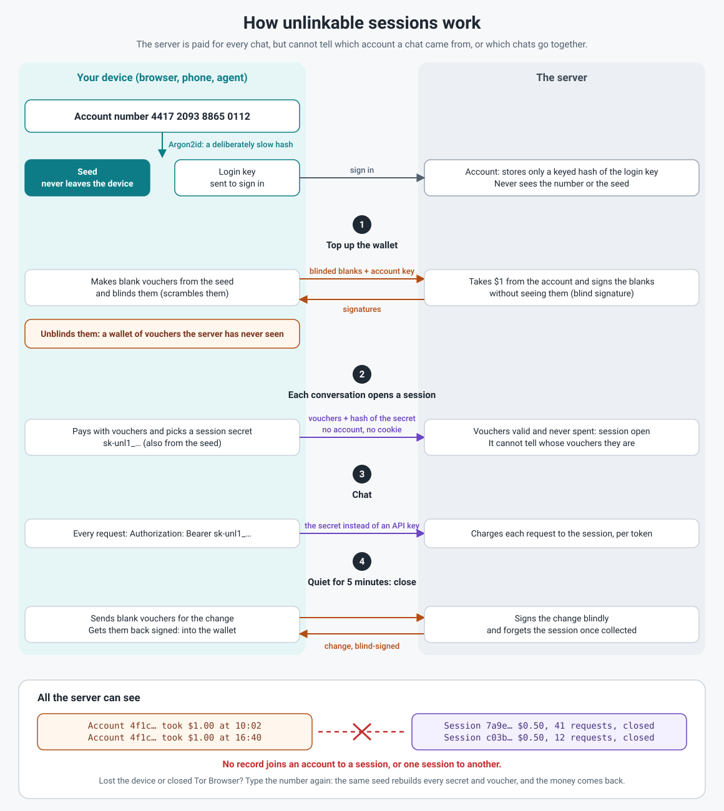

# Unlinkable inference

Use AI models without the server being able to tell which account or payment
a chat came from, or which other chats it goes with. The server still reads
the prompt, and sees your IP address unless you hide it with Tor or a VPN.
[THREAT_MODEL.md](THREAT_MODEL.md) says exactly what is and is not protected;
[SPEC.md](SPEC.md) has the wire format.

How it works, in one paragraph: your device holds a wallet of blind-signed
vouchers (Chaumian e-cash: David Chaum's blind signatures, 1982). Each conversation opens a session paid with a few of them and uses a
random session secret instead of an API key. When the conversation goes quiet
the session closes and the change comes back as fresh vouchers the server has
never seen. Everything is derived from the account number, so a device that
forgets it all gets the money back at the next sign-in. Nothing depends on a
third party.



## Use it in an app

The client logic is one Rust crate, `unlinkable-inference`; browsers get the same
code as WebAssembly in the npm package `unlinkable-inference`.

**Rust** (`cargo add unlinkable-inference`):

```rust
use unlinkable_inference::{manager::Manager, seed::account_keys};

let keys = account_keys(&number)?;            // slow on purpose, ~1 s
// sign in with keys.login_key; keep keys.seed on the device
let mut m = Manager::connect(server, keys.seed, saved.as_deref()).await?;
m.api_key = Some(api_key);                     // used only to top the wallet up
m.start().await?;                              // brings back what a lost device left
let secret = m.session(&conversation_id).await?; // send as Authorization: Bearer
save(m.state());                               // after every call
// 402: m.ran_out(&secret, attempt), retry. 401: m.expired(&secret), new session.
// Every 30 s: m.tick().await (closes quiet sessions for their change, tops up).
```

**Browser** (`npm install unlinkable-inference`):

```js
import * as sessions from 'unlinkable-inference';

const { loginKey, seed } = await sessions.keys(number); // sign in with loginKey
const u = await sessions.connect({ seed, apiKey });     // wallet kept in localStorage
const res = await u.fetch('/v1/chat/completions', { method: 'POST', headers, body }, { chat: conversationId });
```

`u.fetch` sends the conversation's session secret with `credentials: 'omit'`,
so no cookie goes with it, and tops the session up when it runs out.

## Packages

| Package | What | Licence |
|---|---|---|
| [`unlinkable-inference`](lib) (crate) | The library. Client: blind vouchers, wallet, sessions, key pinning, recovery from the account number, `Manager` for apps. With the `server` feature: the session endpoints and voucher checks (axum) over your storage. | MIT or Apache-2.0 |
| `unlinkable-inference` (npm) | The same client compiled to WebAssembly for web pages ([`wasm`](wasm), `wasm/build.sh`) | MIT or Apache-2.0 |
| [`unlinkable-inference-cli`](cli) (crate) | `unlinkable-inference`: local OpenAI/Anthropic proxy, MCP server, wallet CLI, `verify` | GPL-3.0-or-later |

[`reference-server`](reference-server) is not published: the server feature over
in-memory storage with an echo model, play money and a full database dump, for
the tests and for checking what a server learns.

## Use it with any agent

```sh
cargo install unlinkable-inference-cli   # or, from this repo: cargo install --path cli
```

**As an MCP server** (Claude Code, Codex, anything with MCP): the agent starts
the proxy and stops it when it exits, closing its sessions. The server entry
has no tools:

```json
{"mcpServers": {"unlinkable-inference": {"command": "unlinkable-inference", "args": ["mcp"],
  "env": {"OBSCURIFY_API_KEY": "sk-obs1_…"}}}}
```

Claude Code then keeps talking to the server directly; only the key changes,
to a session secret from the proxy. In `.claude/settings.json`:

```json
{"apiKeyHelper": "unlinkable-inference key",
 "env": {"ANTHROPIC_BASE_URL": "https://obscurify.ai"}}
```

One session lasts until Claude Code goes quiet for 5 minutes; the proxy tops
it up as it runs low. Codex has no key helper, so it goes through the proxy
instead, as a provider in `~/.codex/config.toml`:

```toml
[model_providers.obscurify-private]
name = "Obscurify (private)"
base_url = "http://127.0.0.1:8899/v1"
env_key = "OBSCURIFY_API_KEY"
```

and a profile next to it, `~/.codex/private.config.toml` (Codex 0.169+; `codex --profile private`):

```toml
model_provider = "obscurify-private"
model = "deepseek/deepseek-v4.1-flash"
```

Step-by-step for every client: https://obscurify.ai/tutorials/private_sessions

**pi**: copy `integrations/pi/unlinkable-inference.ts` to `~/.pi/agent/extensions/`. It
starts the proxy when needed and adds an `obscurify-private` provider with the
same models as your `obscurify` one; the normal provider stays.

**On its own**: `unlinkable-inference serve` (http://127.0.0.1:8899), then use your
usual key and change only the base URL, e.g. Claude Code:

```sh
ANTHROPIC_BASE_URL=http://127.0.0.1:8899 ANTHROPIC_AUTH_TOKEN=sk-obs1_… \
ANTHROPIC_MODEL=deepseek/deepseek-v4.1-flash claude
```

OpenAI SDKs and curl: base URL `http://127.0.0.1:8899/v1`, your usual key.
The proxy uses that key for one thing: keeping the wallet (and this month's
passes, on a plan) topped up in the background. Chats go out with a session
secret instead and are charged exactly their tokens, down to 0.001¢.

`http://127.0.0.1:8899/_unlinkable` shows what the server received for each
request. To hide your IP address too, run the proxy behind Tor or a VPN
(`HTTPS_PROXY` / `ALL_PROXY` are honoured).

## Verify it yourself

1. Open `/_unlinkable`, or run with `--show-traffic`: requests carry a
   session secret, no cookie, no account key.
2. `unlinkable-inference verify` compares the keys the server gives you with your pins
   and the published pins, and prints what the server received.
3. `./verify.sh` rebuilds the binaries in a pinned container and compares
   hashes with a release.
4. Run the reference stack (`compose/`), use it, then read
   `http://127.0.0.1:8250/debug/db` (everything the server has) and try to
   tie a session to the withdrawal that paid for it. `cargo test` does this
   automatically.

## Tests

`cargo test` runs the reference server and the proxy over real sockets:
withdraw, open, stream (OpenAI and Anthropic), close, change, pinning, retries
after lost answers, spent vouchers; then it reads the server's whole database
and checks nothing links.
